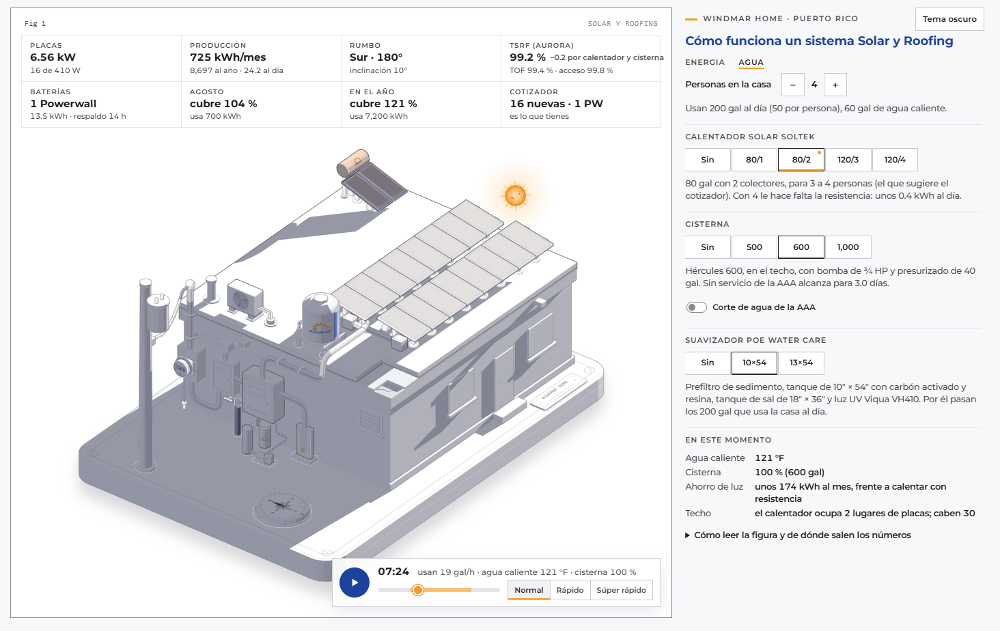

# Figura Solar y Roofing

Figura interactiva que explica cómo funciona un sistema **Solar y Roofing de Windmar Home** en Puerto Rico: el techo sellado, las placas, el inversor, las baterías y el medidor de LUMA. Mueves la hora del día y la energía corre por los conductos hacia la casa, la batería o LUMA; el sol da la vuelta por fuera de la maqueta del lado de donde viene su luz, cada pieza echa su sombra y de noche sale la luna. Con el consumo de cada mes del cliente puedes sumar o quitar placas y baterías y ver cuánto cubren, y con la brújula de la base, cambiar hacia dónde miran las placas y ver cuánto sol les llega, con las mismas medidas que Aurora (TOF, acceso solar y TSRF). En la pestaña Agua se ponen el calentador solar y la cisterna de Windmar Water según las personas de la casa, y se ve el agua correr, calentarse y guardarse.

**En línea:** https://figura-solar-y-roofing.vercel.app


## Qué se puede hacer

En pantalla ancha todo cabe en una sola pantalla: la casa a la izquierda, con todo el alto de la ventana, y el título y los controles a la derecha, con placas y baterías arriba. La ficha va al lado de la casa (en columna en una laptop, en una franja arriba en una pantalla más alta) y el reproductor del día flota en la esquina de abajo a la derecha, donde el dibujo no tiene nada. Solo se baja si se abre "Cómo leer la figura y de dónde salen los números" o la tabla de los 12 meses. En el teléfono la casa va primero, luego el reproductor, la ficha y los controles.

- **Correr el día como en un reproductor de música:** play y pausa, la barra de 24 horas (la franja clara es el sol, de 6:25 a 18:25) y tres velocidades: Normal (media hora cada 2 segundos), Rápido (una hora por segundo) y Súper rápido (tres horas por segundo). Al lado de la hora se lee lo que pasa en ese momento: kW de las placas, % de batería y kWh enviados a LUMA o tomados de LUMA en el día. También se salta de hora con las escenas (Madrugada, Mañana, Tarde, Noche) o con el teclado sobre la figura: flechas (con Mayús, de 3 en 3 horas) y la barra espaciadora para pausar. Pasar el mouse por encima ya no cambia la hora. Con el movimiento reducido del sistema el día no corre solo y queda la barra.
- **Escribir el consumo de cada mes**, como en la factura de LUMA: eliges un mes y escribes sus kWh, arrastras su barra en la gráfica o llenas los 12 meses de una vez. Con el promedio y el mes pico, la regla del cotizador de LUMA de Sun Bot sugiere las placas nuevas y las baterías.
- **Sumar y quitar:**
  - placas nuevas de 410 W;
  - placas que el cliente ya tiene, con sus vatios (330 W por defecto, como el cotizador);
  - de 0 a 4 Powerwall.

  Las placas caen al techo y se asientan, y las baterías entran deslizándose. Las que el cliente ya tenía se ven con vidrio claro. "Volver a lo sugerido" regresa a lo que dice el cotizador.
- **Cambiar hacia dónde miran las placas** con los ocho rumbos (N, NE, E, SE, S, SO, O, NO). La tarjeta de la brújula de la base gira y su marca fija, como la línea de fe de un barco, señala el rumbo; el sol, las sombras y la producción cambian con él.
- **Ver las sombras de cada momento:** las de la casa, el poste, el mástil, el aire, el equipo de la fachada y las mismas filas de placas, sobre la base, las paredes, el techo y las placas. Las caras que le dan la espalda al sol se oscurecen poco a poco.
- **Poner el agua de Windmar Water** en la pestaña Agua, con los equipos del cotizador Water de Sun Bot:
  - cuántas personas viven en la casa (usan 50 galones al día cada una, 15 de ellos de agua caliente);
  - el calentador solar Soltek (80/1, 80/2, 120/3 o 120/4). Un punto naranja marca el que sugiere el cotizador para esas personas. Va al fondo del techo, en el lugar de las últimas placas, así que el techo admite menos placas;
  - la cisterna: Eco 500, Hércules 600 o Eco 1,000, todas en el techo, con su bomba y su presurizado junto a la pared. La Torre 150 va adentro, pegada a la pared, y queda para cuando se dibuje el apartamento;
  - el corte de agua de la AAA: la cisterna deja de llenarse y baja con lo que se usa;
  - el suavizador POE Water Care (10×54 o 13×54) donde el agua entra a la casa: prefiltro, tanque de resina con su válvula, tanque de sal y luz UV. El agua le llega de la bomba, o de la AAA si no hay cisterna.

  Al abrir la pestaña por primera vez bajan el calentador sugerido, la Hércules 600 y el suavizador 10×54. El agua corre por los tubos en azul (la caliente, en rojizo) con el uso de cada hora y la energía queda tenue. Los tubos de cobre de los colectores brillan con el sol, el tanque toma color con la temperatura, la mirilla de la cisterna muestra el nivel y la luz de la bomba prende cuando bombea. Las cisternas y el tanque del calentador llevan el logo de Windmar al frente, pegado a su curva como una calcomanía; la mirilla queda a su derecha. El panel dice la temperatura del agua caliente, el nivel de la cisterna, la luz que ahorra el calentador y para cuántos días alcanza la cisterna sin servicio. La sombra de la Hércules y la del calentador cuentan en el acceso solar, y la ficha dice cuánto baja el TSRF por ellas.
- **Ver salir el sol y la luna:** el sol da la vuelta por fuera de la maqueta, siempre del lado de donde viene su luz: con las placas al sur sale por atrás a la derecha, a mediodía va arriba y de tarde baja por el frente a la izquierda, y las sombras caen del lado contrario. Nunca pasa por detrás de la casa. Al ponerse, la tarjeta pasa del día a la noche y sale la luna llena, que hace el mismo camino. El sol tiene su granulado, dos manchas, el borde más oscuro y una corona que gira despacio; la luna, sus mares, los cráteres claros y los rayos de Tycho. En tema claro la noche es azul oscuro; en tema oscuro, más azul todavía.
- **Leer la ficha** al lado de la casa: placas y kW, producción al mes y al año, rumbo e inclinación, el TSRF con su TOF y su acceso solar (como en Aurora, con un decimal para que se vean las sombras chicas), baterías y horas de respaldo de noche, cuánto cubren las placas el mes elegido y el año, y lo que sugiere el cotizador.
- **Comparar los 12 meses** en la gráfica: cada barra es el consumo del mes, en naranja lo que cubren las placas y en azul lo que viene de LUMA; la línea es la producción al mes.
- **Pasar a tema oscuro** y volver al claro. Los dos usan la paleta oficial de Windmar Home y la letra Montserrat.





Las placas nuevas bajan al techo cuando se suman:


## Cómo correrlo

Solo hace falta Node 20 o más nuevo; no hay dependencias.

```bash
npm run build
```

Escribe `public/index.html`; ábrelo en el navegador.

```bash
npm run audit
```

Construye y además audita la geometría: que ningún conducto atraviese nada, que cada extremo llegue a una pieza y que el orden de pintado sea el correcto. Tiene que terminar en `audit passed`.

`npm run capture` y `npm run lines` sacan capturas y revisan que cada línea termine sobre algo; usan Google Chrome.

Cada subida a `main` se publica sola en Vercel (team jnsbstnprojects), que corre `node src/build.mjs` y sirve `public/`.

## Estructura

| Ruta | Qué es |
|---|---|
| `src/build.mjs` | Arma la figura: geometría, orden de pintado y la página |
| `src/model.mjs` | Regla de dimensionamiento y modelo de energía del día; corre en la construcción y en la página |
| `src/sol.mjs` | El sol y la luna del día, los rumbos de PVWatts, el año típico de PVGIS y lo que tapa el sol (acceso solar y forma del día); corre en la construcción y en la página |
| `src/agua.mjs` | El día del agua: el uso por hora, el nivel de la cisterna, la temperatura del calentador solar, la resistencia que hace falta y la luz que ahorra; corre en la construcción y en la página |
| `src/productos.mjs` | El plano: los productos que se ponen y se quitan desde el panel (hoy el calentador solar y la cisterna), con sus modelos, sus partes y su nota; corre en la construcción y en la página |
| `src/logo.mjs` | El logo de Windmar en mínimo (el sol, el molino y "windmar"), calcado del de Windmar Water de Sun Bot |
| `src/live.js` | Lo que se mueve: el reproductor del día, el flujo de energía, placas y baterías que entran y salen, la brújula, el cielo, las sombras, ficha, gráfica, escenas y tema |
| `src/page.css` | Estilos de la página, con la paleta y la letra de la marca Windmar |
| `public/index.html` | La página construida, la que publica Vercel |
| `vendor/anatomy/` | Kit de figuras isométricas Anatomy, con su licencia MIT |
| `docs/` | Capturas |

## El plano: agregar o quitar un producto

Los productos que se escogen por modelo (con un botón "Sin" y uno por modelo) están en `src/productos.mjs`. Para agregar uno:

1. **Una entrada en `PRODUCTOS`**, con:
   - en qué pestaña va y sus títulos;
   - cómo se nombra en las frases ("el calentador");
   - sus modelos, con los datos del cotizador de Sun Bot;
   - sus partes: las piezas que se ven solo con algunos modelos, como los colectores del calentador. Una parte también puede mirar lo escogido de otro producto: el tubo de la bomba va derecho a la casa si no hay suavizador, y al suavizador si lo hay;
   - en qué escena va cada modelo (`escenas`): la casa, o el apartamento cuando exista (ahí queda guardada la Torre 150);
   - la nota que dice el panel.

   Si ocupa lugares de placas del techo, va en `lugares`. Si lleva el logo de Windmar, va `logo: true`.
2. **Su dibujo en `DIBUJOS`** de `src/build.mjs`, con el mismo id:
   - `lienzo(m)`: los puntos más altos de cada modelo, si sobresale de la casa;
   - `cielo(m)`: su caja, para que el sol y la luna le den la vuelta;
   - `dibujar(p)`: sus piezas con el kit. Cada pieza lleva `parte(id, modelo o parte)`. El logo se pega con `logoEnCilindro`.

Lo demás sale solo:

- su sección en el panel, con el punto naranja en el modelo que sugiere el cotizador si sus modelos dicen para cuántas personas son;
- que sus piezas bajen y suban con resorte al escogerlas;
- su sombra y, si va en el techo, lo que le quita al acceso solar y al TSRF de las placas;
- los lugares de placas que ocupa;
- el orden de pintado, sin mezclar modelos que nunca se ven juntos.

Para quitarlo se borran las dos cosas. Lo que el producto haga en el día del agua o de la energía va aparte, en `agua.mjs` o `model.mjs`, según su `rol` (hoy `calentador` y `cisterna`).

Las placas y los Powerwall no van en el plano. Son el sistema que arma el cotizador de LUMA: se cuentan, no se escogen, y tienen sus propios controles en la pestaña Energía.

## De dónde salen los números

Del cotizador de LUMA de Sun Bot (Windmar Home):

- Placa nueva QCells Q.PEAK DUO BLK ML-G10+ de 410 W. Las placas que el cliente ya tiene van a 330 W por defecto, como en el cotizador.
- 4.5 horas de sol pico en Puerto Rico (NREL), las mismas todo el año, y 0.82 de rendimiento. Una placa da sus vatios × 4.5 × 0.82 ÷ 1000 kWh al día: 1.51 kWh una de 410 W.
- La meta es el mayor entre 110 % del promedio de los 12 meses y el mes pico. Los kW necesarios son (meta ÷ 30) ÷ (4.5 × 0.82).
- A los kW necesarios se les restan los de las placas que ya tiene; lo que falta se cubre con placas de 410 W, redondeando hacia arriba.
- Powerwall de 13.5 kWh, que cubren la mitad del consumo diario, al menos uno. Con batería, el cotizador pide al menos 8 placas. Se pueden poner de 0 a 4.
- Las horas de respaldo son las de la herramienta Enseres: baterías × 13.5 ÷ consumo diario × 24, hasta 24 h.
- Techo con el sellado de silicona Gardner de los Planes de Sellado: imprimador Elasto Prime y una capa continua de silicona blanca, y Roof Patch en anclajes y penetraciones.

Con la factura de ejemplo (promedio de 600 kWh al mes y pico de 700 en agosto) salen 16 placas nuevas (6.56 kW) y un Powerwall, que producen 726 kWh al mes.

### Rumbo, sombras y las medidas de Aurora

El cotizador da la producción con las placas al sur y sin sombras. La figura la ajusta así:

- **Rumbo**, con [PVWatts v8](https://developer.nlr.gov/docs/solar/pvwatts/) de NREL (hoy NLR) para San Juan (año típico NSRDB PSM V3 tmy-2020), 1 kW a 10° de inclinación y pérdidas estándar de 14 %. En kWh por kW al año:

  | Rumbo | kWh/kW/año | Frente al sur |
  |---|---|---|
  | Sur (180°) | 1,613 | 100 % |
  | Sureste (135°) | 1,600 | 99 % |
  | Suroeste (225°) | 1,583 | 98 % |
  | Este (90°) | 1,554 | 96 % |
  | Oeste (270°) | 1,530 | 95 % |
  | Noreste (45°) | 1,498 | 93 % |
  | Noroeste (315°) | 1,481 | 92 % |
  | Norte (0°) | 1,467 | 91 % |

  Con el sur, la figura da lo mismo que el cotizador; con otro rumbo se multiplica por su porcentaje. El cotizador (4.5 h × 0.82) es más conservador que PVWatts (1,347 contra 1,613 kWh por kW al año), por eso PVWatts se usa solo como proporción.
- **Acceso solar** (Aurora): de todo el sol que le llegaría a cada placa en el año, directo en su plano más el difuso del cielo que ve, qué parte le llega con las sombras. Se calcula con el día típico de cada mes cada media hora, el sol directo y difuso del año típico de [PVGIS](https://re.jrc.ec.europa.eu/pvg_tools/en/) (base PVGIS-NSRDB) y las piezas del dibujo que pueden tapar el sol: el aire, el tubo de ventilación, el mástil, el poste, las cajas de fila, las otras placas y, si se ponen, la cisterna del techo y el calentador solar. Sin ellos da casi 100 %: lo que hay está lejos o es bajo.
- **Lo de agua en el techo:** la Hércules 600 (56" × 61", sobre una base de hierro de unos 45 cm, a unos 60 cm del extremo oeste de las filas) y el calentador solar (al fondo del techo). Sus sombras cuentan en el acceso solar del año y en la forma del día. Como les dan sombra con el sol bajo, en el año quitan poco. Con las 16 placas del ejemplo y la Hércules sola:
  - Mirando al sur, la placa más cercana pierde unos 3.5 % de su sol y el sistema unas décimas de TSRF; mirando al norte, unos 4.4 %. Mirando al este o al oeste casi no se nota.
  - En el día del equinoccio, mirando al sur, la sombra se lleva hasta 9 % de la producción entre las 4 y las 6 de la tarde; mirando al norte, hasta 14 % a las 7 de la mañana.

  Por eso la ficha muestra el TSRF y el acceso con un decimal, y al lado del TSRF cuánto baja por la cisterna, por el calentador o por los dos.
- **TOF** (Aurora): el sol que recibe el plano de las placas frente al mejor plano de San Juan, sur a unos 17° (la curva por PVWatts a 0°, 10° y 15° llega a 5.889 kWh/m² al día). El sur a 10° da 99 %.
- **TSRF** (Aurora): TOF × acceso solar.
- La producción de la ficha y de la gráfica es la del cotizador por el rumbo y por el acceso solar. En el día, la producción sigue al sol directo y difuso de marzo y septiembre (PVGIS) sobre el plano de las placas, menos lo que tapan las sombras.

### El agua (Windmar Water)

Equipos y medidas del cotizador Water de Sun Bot (`src/components/crm/cotizadores/water/constants.ts`) y de su PDF maestro (`public/cotizadores/water/Master_Cotizacion_ES.pdf`).

**Calentadores solares Soltek.** Colectores de 34" × 76" con 7 tubos de cobre y resistencia de respaldo de 4,500 W. Van al fondo del techo, en el extremo este de la última fila, inclinados 18°:

| Modelo | Tanque | Colectores | Personas | Lugares de placas |
|---|---|---|---|---|
| 80/1 | 82 gal, 53½" × 23½" | 1 | 1 a 2 | 2 |
| 80/2 | 82 gal | 2 | 3 a 4 | 2 |
| 120/3 | 119 gal, 63" × 28" | 3 | 5 a 6 | 3 |
| 120/4 | 119 gal | 4 | 7 o más | 4 |

El 80/1 y el 80/2 miden de 5 a 7 pies de ancho, más que una placa: por eso ocupan dos lugares.

**Cisternas.** Cada una lleva su bomba y su presurizado, que van en el suelo junto a la pared oeste, debajo del inversor:

| Modelo | Medidas | Dónde va | Bomba | Presurizado |
|---|---|---|---|---|
| Eco 500 | 74" × 32" | techo | ¾ HP | 40 gal |
| Hércules 600 | 56" × 61" | techo | ¾ HP | 40 gal |
| Eco 1,000 | sin medidas en el PDF; se dibuja de 64" × 76" | techo | ¾ HP | 40 gal |
| Torre 150 | 25" × 72" | adentro, pegada a la pared (para el apartamento; no está en la casa) | ½ HP | 6 gal |

Van en la franja oeste del techo, entre las cajas de las filas y el borde. Para que quepa la Eco 500, la más ancha, la casa se alargó 5 unidades hacia el este (unos 19") y las placas se corrieron con ella. La de 600 de Sun Bot se llama Hércules; en la Cotizadora Central, Ecowater 600. El agua baja por dentro de la casa: su tubo entra al techo por una bota sellada con Roof Patch.

**Suavizador POE Water Care** (`trat-poe` del cotizador y la página "Tratamiento de agua · Punto de entrada" del PDF maestro). Va donde el agua entra a la casa, a lo largo de la pared oeste. El agua le llega de la bomba, o de la AAA por un tubo que sube de una caja en el suelo si no hay cisterna.

| Pieza | Qué es | Dónde va |
|---|---|---|
| Prefiltro | sedimento de 5 micras, cartucho lavable en carcasa transparente de 10" | en su bracket, debajo del inversor |
| Tanque Water Care | 10" × 54" con carbón activado y resina (CSPRC1054), o el de 13" × 54" (add-on de más capacidad), con su válvula electrónica arriba | entre el panel y el inversor |
| Tanque de sal | 18" × 36", 280 lb de sal | debajo del inversor, con el logo de Windmar |
| Luz UV Viqua VH410 | 18 GPM | a la salida de la válvula, y de ahí a la pared |

El tanque de sal del 13" × 54" se dibuja igual que el del 10" × 54": el PDF no dice si cambia.

**Supuestos del agua** (decididos por Juan el 21-oct-2026 o del dibujo):

- 50 galones al día por persona, 15 de ellos de agua caliente, repartidos en el día: baños de la mañana y de la noche, cocina al mediodía y en la tarde.
- El agua llega a 80 °F y la caliente se usa a 120 °F. Si el tanque está más frío, entra la resistencia.
- Los colectores le pasan al agua la mitad del sol que les llega (el del plano de las placas del rumbo de la casa, del año típico de PVGIS).
- El tanque pierde un poco de calor por hora y deja de calentar a 160 °F.
- La AAA llena la cisterna mientras da servicio, hasta 300 galones por hora. Con el corte, no entra nada.
- La reserva es los galones de la cisterna entre lo que usa la casa en un día.
- El ahorro de luz compara con calentar la misma agua caliente con una resistencia eléctrica (95 % de eficiencia).

Con 4 personas, el 80/1 necesita unos 3 kWh al día de resistencia y el 80/2 casi nada; el ahorro es de unos 175 a 185 kWh al mes. La Hércules 600 alcanza para 3 días sin servicio.

**Supuestos del dibujo**, que no vienen del cotizador:

- El reparto del consumo por hora.
- La reserva de batería del 20 % y la batería sin pérdidas.
- El sol del equinoccio (sale 6:25, se pone 18:25) con la luna llena de esa noche. El mes se cuenta de 30 días, como en el cotizador.
- El sol y la luna se dibujan por fuera de la maqueta, en la dirección de pantalla de donde viene su luz, justo afuera del contorno del dibujo; si ahí no caben (la esquina de atrás del techo casi toca el borde de arriba), asoman a medias por el borde, y si el reproductor flota encima, se apartan de él. Las sombras salen de formas simples (cajas, cilindros y las placas); los tubos y los anillos se oscurecen enteros, por pedazos.
- Las placas que ya tenía se dibujan del mismo tamaño que las nuevas, y en el techo caben 32.
- El inversor se dibuja más grande que en la realidad para que se lea. El Powerwall 3 trae el inversor integrado; aquí se dibuja aparte para que se vea.

La figura no muestra dinero.

## Créditos

Hecha con el kit [Anatomy](https://github.com/wheresryan22/anatomy) (MIT, © 2026 Ryan), incluido en `vendor/anatomy` con su licencia.
