# Simulador de servicios

El **Simulador de servicios de Windmar Home** (antes "Figura Solar y Roofing"; el repo y la dirección web siguen con ese nombre) es una figura interactiva que explica cómo funcionan en Puerto Rico los servicios de Windmar: Solar y Roofing, Water y Anker. En la casa se ven el techo sellado, las placas, el inversor, las baterías y el medidor de LUMA. Mueves la hora del día y la energía corre por los conductos hacia la casa, la batería o LUMA; el sol pasa por encima de la maqueta, de un lado al otro, cada pieza echa su sombra y de noche sale la luna. Con el consumo de cada mes del cliente puedes sumar o quitar placas y baterías y ver cuánto cubren, y con la brújula de la base, cambiar hacia dónde miran las placas y ver cuánto sol les llega, con las mismas medidas que Aurora (TOF, acceso solar y TSRF). En la pestaña Agua se ponen el calentador solar y la cisterna de Windmar Water según las personas de la casa, y se ve el agua correr, calentarse y guardarse. En la pestaña Anker se pone el respaldo de Anker SOLIX: el portátil con sus placas, el E10 para toda la casa y la nevera EverFrost. En la pestaña Roofing se escoge el plan de sellado del techo (Silver, Gold o Platinum), se ve cómo se aplica por partes y, con un aguacero, por dónde corre el agua con el techo sellado y sin sellar.

Un selector **Casa | Apartamento**, arriba a la derecha de la tarjeta, pasa a la segunda figura: un apartamento con sala, cocina, alcoba y baño, con lo de Windmar que va adentro. Ahí va el Anker SOLIX con sus placas en el balcón y su transfer switch de apartamento, la nevera EverFrost, la cisterna Torre 150 pegada a la pared y la ósmosis inversa debajo del fregadero. Las dos figuras tienen zoom para verlas de cerca, y paredes y techos que se dibujan transparentes para ver adentro.

**En línea:** https://figura-solar-y-roofing.vercel.app (la casa) y https://figura-solar-y-roofing.vercel.app/apartamento.html (el apartamento)

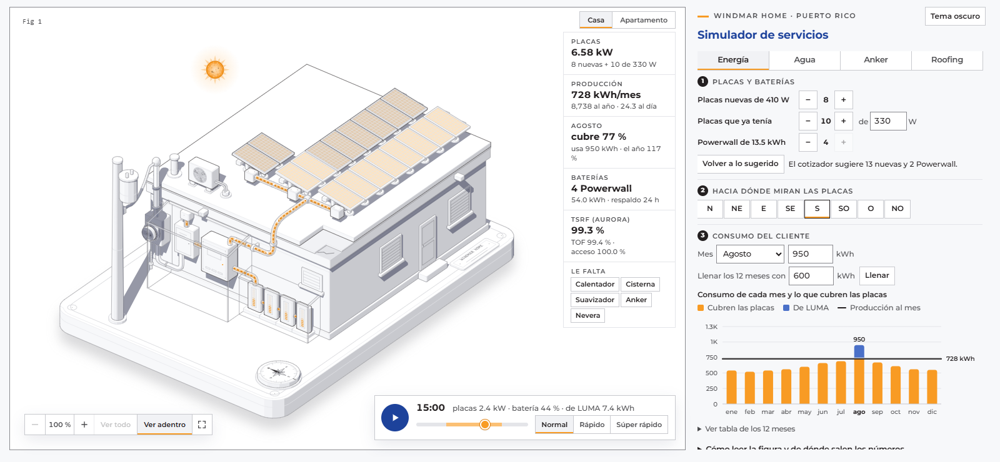

## Qué se puede hacer

En pantalla ancha todo cabe en una sola pantalla: la casa a la izquierda, con todo el alto de la ventana, y el título y los controles a la derecha, con placas y baterías arriba. La ficha va al lado de la casa (en columna en una laptop, en una franja arriba en una pantalla más alta) y el reproductor del día flota en la esquina de abajo a la derecha, donde el dibujo no tiene nada. Solo se baja si se abre "Cómo leer la figura y de dónde salen los números" o la tabla de los 12 meses. En el teléfono la casa va primero, luego el reproductor, la ficha y los controles.

Los controles van en pestañas (Energía, Agua, Anker y Roofing; en el apartamento, Anker y Agua), arriba, como botones. Cada pestaña va en pasos numerados en el orden en que se decide, y solo se ve lo que aplica a lo escogido: lo que no aplica se esconde en vez de quedar apagado, y los pasos que se ven se numeran de nuevo. Lo que pasa en cada momento lo dice el reproductor.

- **Correr el día como en un reproductor de música:** play y pausa, la barra de 24 horas (la franja clara es el sol, de 6:25 a 18:25) y tres velocidades: Normal (media hora cada 2 segundos), Rápido (una hora por segundo) y Súper rápido (tres horas por segundo). Al lado de la hora se lee lo que pasa en ese momento: kW de las placas, % de batería y kWh enviados a LUMA o tomados de LUMA en el día. La energía corre por los conductos en trazos naranja gruesos, en el sentido en que va y más rápido con más kW, y el conducto se enciende con un brillo naranja mientras pasa, para que se vea también de día. También se salta de hora con el teclado sobre la figura: flechas (con Mayús, de 3 en 3 horas) y la barra espaciadora para pausar. Pasar el mouse por encima ya no cambia la hora. Con el movimiento reducido del sistema el día no corre solo y queda la barra.
- **Escribir el consumo de cada mes**, como en la factura de LUMA: eliges un mes y escribes sus kWh, arrastras su barra en la gráfica o llenas los 12 meses de una vez. Con el promedio y el mes pico, la regla del cotizador de LUMA de Sun Bot sugiere las placas nuevas y las baterías.
- **Sumar y quitar:**
  - placas nuevas de 410 W;
  - placas que el cliente ya tiene, con sus vatios (330 W por defecto, como el cotizador);
  - de 0 a 4 Powerwall.

  Las placas caen al techo y se asientan, y las baterías entran deslizándose. Las que el cliente ya tenía se ven con vidrio claro. "Volver a lo sugerido" regresa a lo que dice el cotizador.
- **Cambiar hacia dónde miran las placas** con los ocho rumbos (N, NE, E, SE, S, SO, O, NO). La tarjeta de la brújula de la base gira y su marca fija, como la línea de fe de un barco, señala el rumbo; el sol, las sombras y la producción cambian con él.
- **Acercar y ver de cerca:** abajo a la izquierda de la figura, − y + acercan y alejan (de 100 % a 800 %), "Ver todo" vuelve a la figura entera y el último botón la pone en pantalla completa (donde el navegador lo deja; en el iPhone no). También acercan la rueda del mouse (sola si la página no se mueve con ella; si no, con Ctrl), el doble clic (con Mayús aleja), el pellizco en el teléfono y las teclas + y − sobre la figura (el 0 la vuelve a mostrar entera); con zoom, el dibujo se arrastra con el mouse o el dedo (arrastrar no selecciona texto ni levanta la imagen). El dibujo es de vectores: queda nítido y sus líneas, finas.
- **Ver adentro:** las paredes y los techos de lo que va adentro (el cuarto de equipos y la caseta de los Powerwall de la casa, y el apartamento) son del todo transparentes: quedan sus bordes, sin las puertas, ventanas y rejillas dibujadas en su cara y sin su sombra, así que adentro se ve claro. El botón "Ver adentro", al lado del zoom, los cierra y se ven como de verdad, con su sombra. La energía del día los cuenta siempre.
- **Ver las sombras de cada momento:** las de la casa, el poste, el mástil, el aire, el equipo de la fachada y las mismas filas de placas, sobre la base, las paredes, el techo y las placas. Las caras que le dan la espalda al sol se oscurecen poco a poco.
- **Ver el equipo de tierra adentro:** la bomba y el presurizado, el suavizador, el Anker (el portátil o el E10) y la nevera EverFrost van en un cuarto de equipos de bloques pegado a la fachada oeste, con su puerta y sus persianas de ventilación; adentro quedan también el panel y el inversor. Nada de eso se deja a la intemperie: la F2600 no tiene protección contra el agua y la F3800 Plus no es impermeable. Los Powerwall están hechos para afuera, pero van en su caseta, más baja, pegada a la pared sur del cuarto: así no les da el sol directo, que los calienta, ni les pega lo que vuela en un huracán. Su techo queda debajo de la ventana del oeste y cada hoja de sus dos puertas dobles (una por cada dos Powerwall) lleva una rejilla abajo y otra arriba, para que el aire entre fresco y salga caliente. La caseta sale con el primer Powerwall. El medidor de LUMA, el mástil y el generador del E10 quedan fuera, y lo que cruza una pared (el conducto de las placas, el de las baterías y el de la acometida) llega a ella por los dos lados. El cuarto da sombra como de verdad: de mañana les quita sol a las PS400 más cercanas.
- **Poner el agua de Windmar Water** en la pestaña Agua, con los equipos del cotizador Water de Sun Bot:
  - cuántas personas viven en la casa (usan 50 galones al día cada una, 15 de ellos de agua caliente);
  - el calentador solar Soltek (80/1, 80/2, 120/3 o 120/4). Un punto naranja marca el que sugiere el cotizador para esas personas. Va al fondo del techo, en el lugar de las últimas placas, así que el techo admite menos placas;
  - la cisterna: Eco 500, Hércules 600 o Eco 1,000, todas en el techo, con su bomba y su presurizado junto a la pared. La Torre 150 va adentro, pegada a la pared, en el apartamento;
  - el corte de agua de la AAA: la cisterna deja de llenarse y baja con lo que se usa;
  - el suavizador POE Water Care (10×54 o 13×54) donde el agua entra a la casa: prefiltro, tanque de resina con su válvula, tanque de sal y luz UV. El agua le llega de la bomba, o de la AAA si no hay cisterna.

  Al abrir la pestaña por primera vez bajan el calentador sugerido, la Hércules 600 y el suavizador 10×54. El agua corre por los tubos en azul (la caliente, en rojizo) con el uso de cada hora y la energía queda tenue. Los tubos de cobre de los colectores brillan con el sol, el tanque toma color con la temperatura, la mirilla de la cisterna muestra el nivel y la luz de la bomba prende cuando bombea. Las cisternas y el tanque del calentador llevan el logo de Windmar al frente, pegado a su curva como una calcomanía; la mirilla queda a su derecha. El reproductor dice la temperatura del agua caliente y el nivel de la cisterna; el panel, la luz que ahorra el calentador y para cuántos días alcanza la cisterna sin servicio. La sombra de la Hércules y la del calentador cuentan en el acceso solar, y la ficha dice cuánto baja el TSRF por ellas.
- **Poner un Anker SOLIX** en la pestaña Anker, aparte de las placas del techo, con lo que vende el cotizador Anker de Sun Bot. Va en pasos: 1, el tipo de respaldo (Sin, Portátil o E10); 2, el modelo o el kit; 3, sus placas o sus baterías, con hasta cuántas admite y lo que da en el día; 4, los extras, si van con el modelo (las PS200 de la F2600 o el generador del E10). Aparte va la nevera.
  - el portátil: la F2600 o la F3800 Plus, cada una con o sin su batería de expansión (la BP2600 o la BP3800), con sus placas abiertas en el patio y su transfer switch junto al panel (el automático no va con la F2600). Las placas se suman y se quitan con − y +, de una hasta las que admite la estación según su ficha: dos PS400 la F2600 y ocho la F3800 Plus. La F2600 también puede llevar PS200 (200 W), hasta cuatro, con su interruptor: el cotizador no las deja con la F3800 Plus;
  - el SOLIX E10, para toda la casa: el kit Portátil (en su carrito; su botón dice "Carrito", para no confundirlo con el portátil), el MTS (con la Smart Inlet Box), el ATS (con la Power Dock, que pasa toda la casa sola) o el Solar (el ATS con 4 placas de 400 W en el patio). Va en el cuarto de equipos contra su pared norte, de una a cinco baterías B6000 con el módulo de poder encima; con cuatro o más, en la montura de pared. El Smart Generator 5500 se prende con su interruptor: va afuera, nunca adentro, y si la batería llega a su reserva la vuelve a cargar. Es el otro tipo de respaldo: no va junto con el portátil, y al volver a cualquiera de los dos vuelve lo que tenía;
  - la nevera portátil EverFrost 40 (43 L) o 50 (53 L, con dos zonas), con su batería de 299 Wh, en el cuarto de equipos.

  El Anker mantiene lo esencial de la casa: de día lo cubren sus placas y lo que sobra carga la batería; de noche lo da la batería, y si llega a su reserva, LUMA. El E10 sin placas es solo respaldo: LUMA lo mantiene lleno y entra en un apagón. Las luces de la estación dicen su carga, el vidrio de las placas se ilumina con el sol, su sombra, la de la casa y la del cuarto les quitan sol, y el panel dice cuánto de lo esencial le dan las placas en el día y para cuántas horas alcanza sin LUMA.
- **Sellar el techo** en la pestaña Roofing, con los Planes de Sellado del cotizador de Roofing de Sun Bot. Va en pasos:
  1. el plan: Sin, Silver, Gold o Platinum. La casa abre con Gold puesto: es un sistema Solar y Roofing. Los tres llevan la misma silicona Gardner sobre imprimador, sin uniones, y la garantía del fabricante de por vida; cambian la mano de obra (1 año en Silver, 10 en Gold y Platinum, con las rectificaciones del aire y el calentador) y el mantenimiento (Platinum limpia el techo y las placas cada 2 años por 10 años). Sin plan, el techo es el concreto como está, con su grieta abierta en la esquina;
  2. el techo de antes: cuánto del sellado viejo se quita, de 0 a 100 % de 10 en 10, como en el cotizador. Cada 10 % es un parche de sellado viejo pelándose en el techo de antes; con un plan puesto, al cambiarlo se ve un momento cómo estaba;
  3. el área del techo, que se cotiza con su mínimo: 1,000 pies², o 750 si ya es cliente solar de Windmar (la casa mide los 1,250 del techo promedio de Puerto Rico);
  4. míralo: "Ver cómo se sella" aplica el sellado por partes, de norte a sur, en unos 15 segundos, con el borde naranja encendido que avanza. Primero vienen las rectificaciones que incluye el plan: se levanta todo lo del techo (unos 85 cm, pasándose un poco y asentándose arriba), es decir las placas con sus rieles, sus postes, sus cajas de fila y sus conductos; el aire con su tubería y su bota; el calentador solar, si lo hay, y la cisterna, si la hay. Sus sellos de Roof Patch se quedan en el techo, el conducto de las placas se estira desde su abrazadera del borde de la losa y, mientras están arriba, no echan sombra. El tubo de ventilación atraviesa la losa: no se levanta. Después vienen la limpieza a presión, que deja el concreto mojado hasta que se seca; la remoción, con los parches de sellado viejo que se despegan y se van; las grietas con Roof Patch; el imprimador Elasto Prime, con una franja oscura de lo recién puesto detrás del borde, y la silicona, con una franja azulada de lo fresco. Cada cosa baja a su lugar cuando la silicona ya pasó por debajo; las placas, que llegan casi al borde sur, bajan al final. También se aplica solo al escoger un plan desde "Sin". El aguacero llueve sobre la figura y nubla el sol: con el sellado, el agua corre por el techo a las dos gárgolas, baja por ellas y cae al suelo (la del oeste, por el techo del cuarto); sin sellar, el concreto se moja, los charcos crecen uno tras otro con las ondas de la lluvia, el agua corre hacia la grieta, gotea por debajo de la losa (tres goteras al pie de la fachada sur, donde hace un charco, y una en el alféizar de la ventana del oeste), escurre por la pared y las manchas de humedad se extienden en las dos fachadas de la esquina. La lluvia es para verlo: no cambia la energía del día.
- **Ver salir el sol y la luna:** el sol pasa por encima de la maqueta en un arco: sale por el lado del este (con las placas al sur, por la derecha), sube, a mediodía va sobre la casa y se pone por el otro lado, y las sombras caen del lado contrario. Nunca pasa por debajo ni por detrás de la casa. Al ponerse, la tarjeta pasa del día a la noche y sale la luna llena, que hace el mismo camino. El sol tiene su granulado, dos manchas, el borde más oscuro y una corona que gira despacio; la luna, sus mares, los cráteres claros y los rayos de Tycho. En tema claro la noche es azul oscuro; en tema oscuro, más azul todavía.
- **Leer la ficha** al lado de la casa: cada pestaña tiene la suya, con lo que aporta cada producto escogido (o lo que haría, si falta):
  - **Energía:** placas y kW, producción al mes (con el año y el día), cuánto cubren las placas el mes elegido y el año, baterías y horas de respaldo de noche, y el TSRF con su TOF y su acceso solar (como en Aurora, con un decimal para que se vean las sombras chicas). Lo que sugiere el cotizador va al lado de "Volver a lo sugerido".
  - **Agua:** los galones que usa la casa al día, el calentador con la luz que ahorra al mes, la cisterna con los días que alcanza sin la AAA y el suavizador con los galones que trata.
  - **Anker:** el respaldo con su batería y su potencia, lo que le da el sol a lo esencial en el día, las horas sin LUMA y la nevera con sus horas.
  - **Roofing:** el plan con su mano de obra; el precio en cash y la mensualidad financiada a 10 años, como en la pantalla del cotizador de Roofing; el mantenimiento (Platinum: 5 limpiezas del techo y las placas) y el área que se cotiza, con lo que se quita del sellado viejo.

  La última celda de cada ficha, **Le falta**, dice qué productos no se han puesto (calentador, cisterna, suavizador, Anker, nevera y, sin plan, el sellado; en el apartamento, la ósmosis): es lo que se le puede ofrecer al cliente, y cada botón lleva a su paso.
- **Comparar los 12 meses** en la gráfica: cada barra es el consumo del mes, en naranja lo que cubren las placas y en azul lo que viene de LUMA; la línea es la producción al mes.
- **Pasar a tema oscuro** y volver al claro. Los dos usan la paleta oficial de Windmar Home y la letra Montserrat.
- **Pasar al apartamento** con el selector Casa | Apartamento. Es otra página, con el mismo reproductor, el mismo cielo y las mismas sombras. El apartamento mide unos 6.9 × 8 m: sala con cocina, una alcoba (cama doble, dos mesitas y una cómoda) y un baño (lavamanos con su espejo, inodoro y ducha con su vidrio), al oeste detrás de un tabique. Tiene todas sus paredes y su techo, que se dibujan transparentes, como los tabiques, para ver adentro sin que nada quede a la intemperie; "Ver adentro" los cierra. De noche los cuatro plafones (sala, equipos, alcoba y baño) quedan prendidos y su luz cae en el piso de cada cuarto. La cocina va contra la pared norte, el panel de breakers contra la este y la sala da al balcón del sur, con su puerta corrediza de vidrio y su baranda de vidrio. Tiene dos pestañas:
  - **Anker:** la F2600 o la F3800 Plus, con o sin su batería de expansión, en el piso debajo del panel, con su transfer switch de apartamento en la pared y una o dos placas en el balcón (con − y +; caben dos; con la F2600 pueden ser PS200), y la nevera EverFrost en la cocina. El E10 es solo de la casa: el cotizador no lo vende para apartamento. El cable de las PS400 entra por la puerta corrediza y corre pegado a la pared. También se escoge hacia dónde mira el balcón: la brújula gira y las PS400 reciben el sol de su propio plano, inclinado 40°, así que un balcón al norte da bastante menos.
  - **Agua:** las personas del apartamento, la cisterna Torre 150 en la pared este, con su bomba de ½ HP y su presurizado de 6 gal (con el corte de agua de la AAA), y la ósmosis inversa de 7 etapas debajo del fregadero, con tanque o sin tanque, y su dispensador en el tope. El gabinete del fregadero va abierto para que se vea.

  El apartamento también tiene una ficha por pestaña: en Anker, el Anker, sus placas en el balcón, lo que le da el sol a lo esencial, las horas sin LUMA y la nevera; en Agua, los galones al día, para cuánto alcanza la cisterna sin la AAA y el agua de beber que da la ósmosis. Las dos terminan en "Le falta".

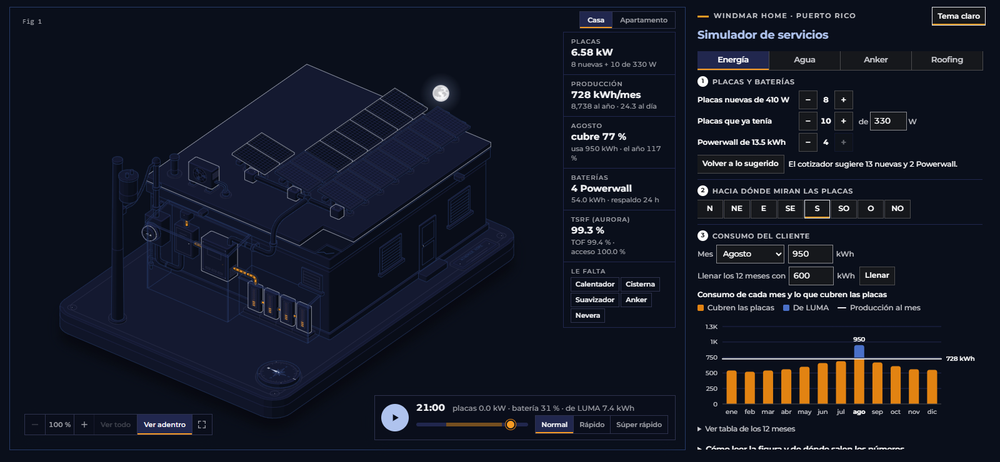

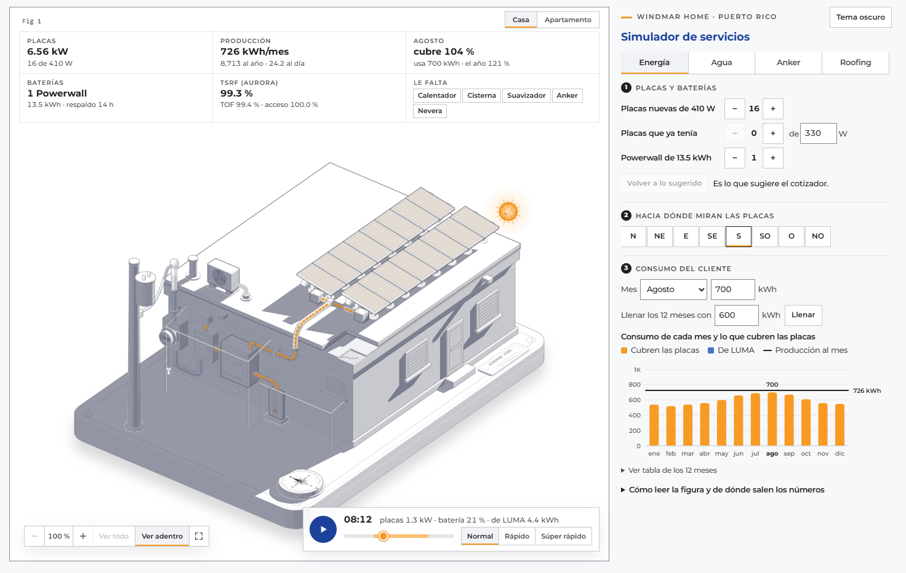

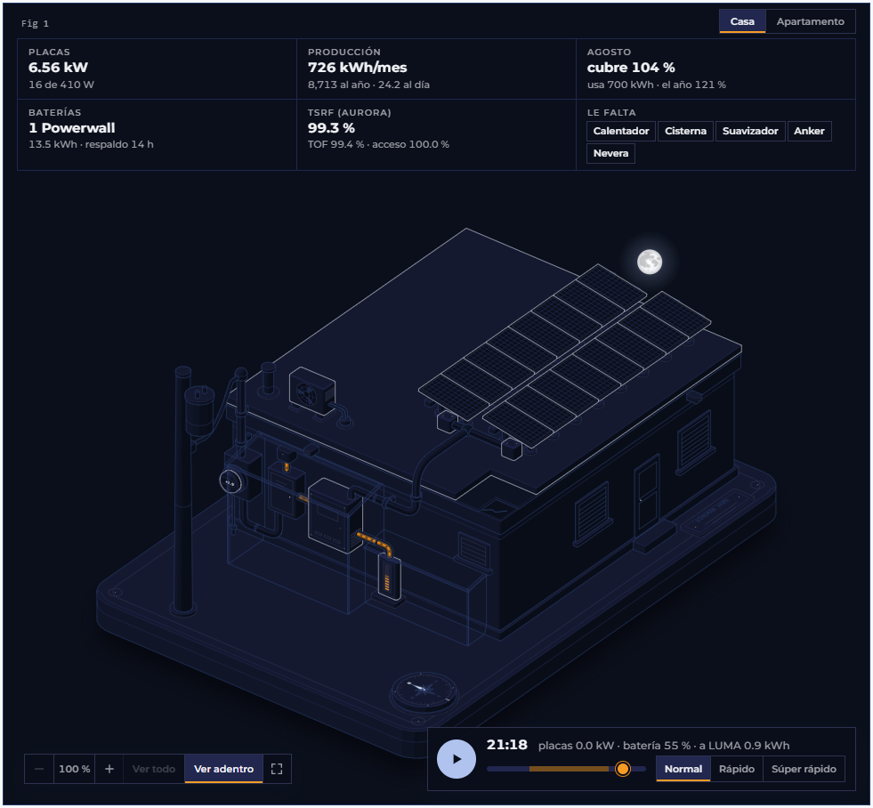


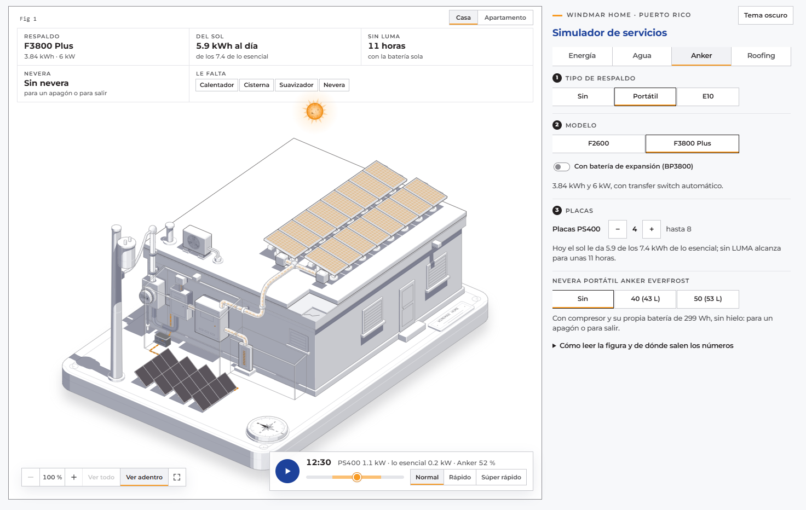

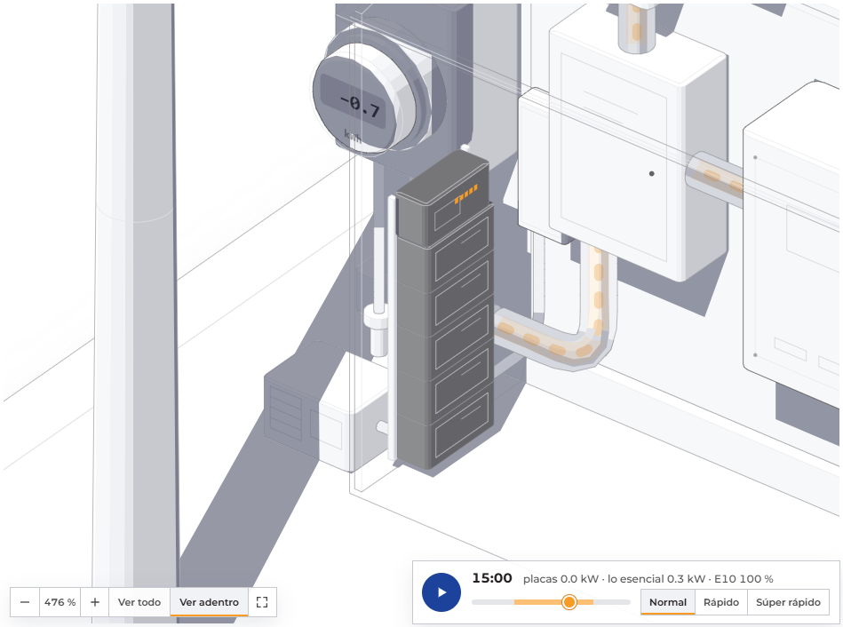

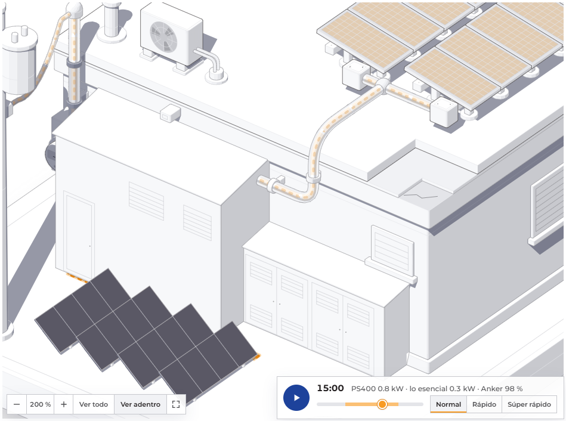


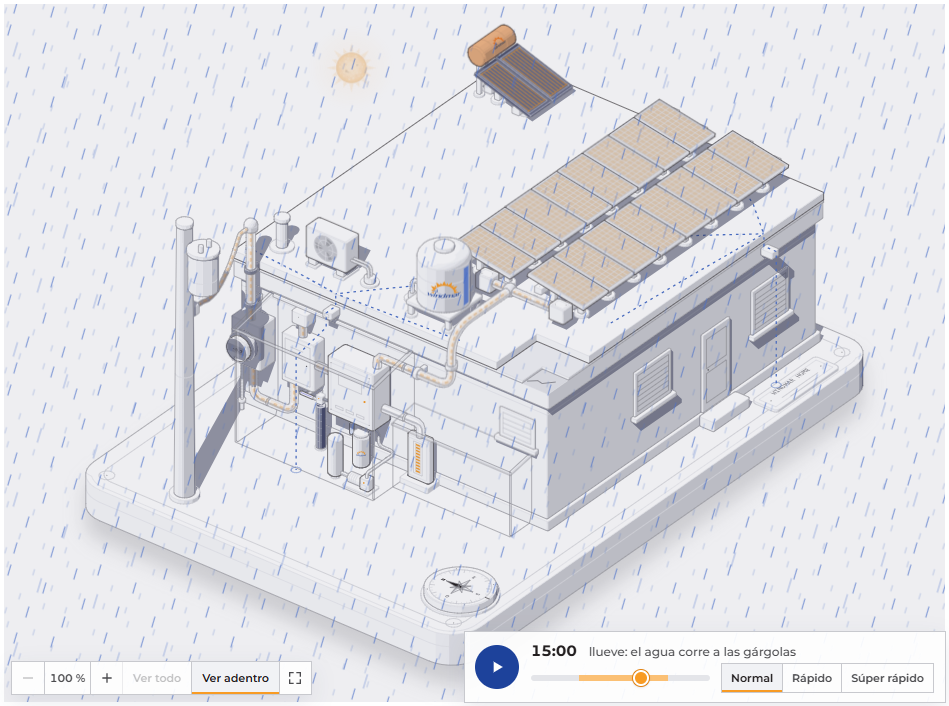


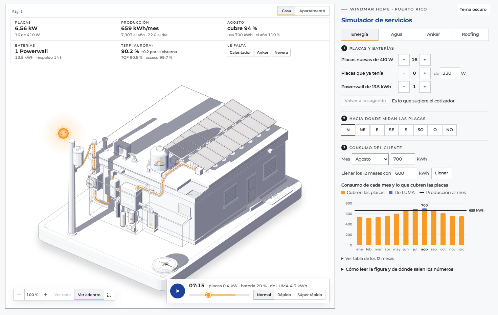

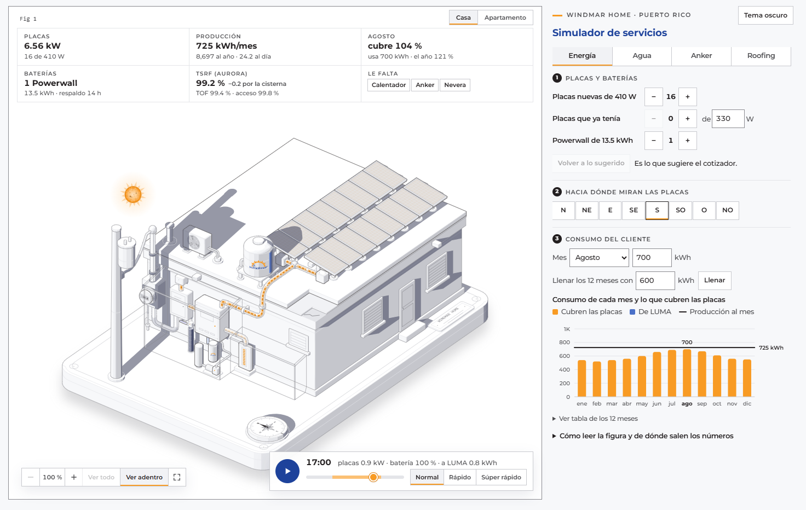


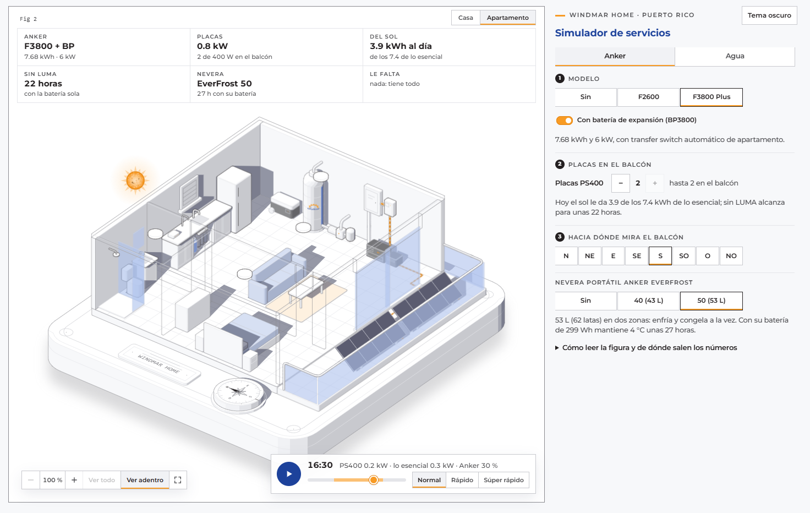

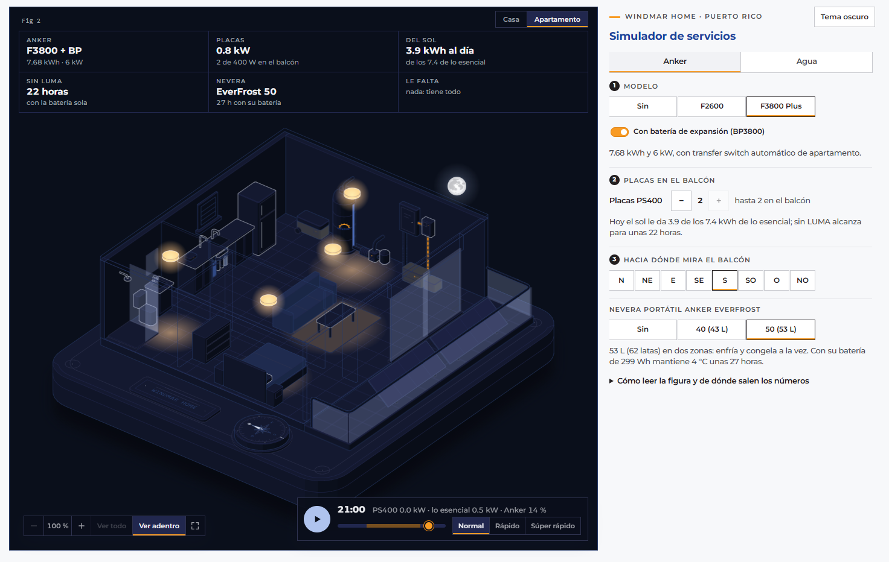

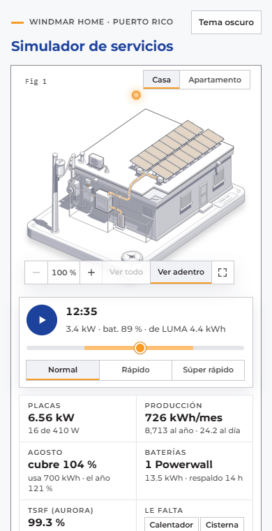


Las placas nuevas bajan al techo cuando se suman:

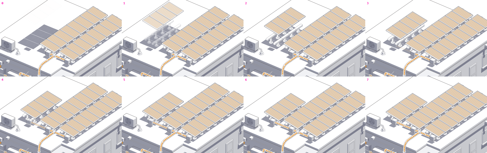

## Cómo correrlo

Solo hace falta Node 20 o más nuevo; no hay dependencias.

```bash
npm run build
```

Escribe `public/index.html` (la casa) y `public/apartamento.html` (el apartamento, que `build.mjs` arma corriendo `src/apartamento.mjs`); ábrelos en el navegador. El selector Casa | Apartamento lleva de una a la otra (`./` y `apartamento.html`).

```bash
npm run audit
```

Construye y además audita la geometría de las dos figuras: que ningún conducto atraviese nada, que cada extremo llegue a una pieza y que el orden de pintado sea el correcto. Tiene que decir `audit passed` dos veces, una por figura; si la del apartamento falla, falla todo.

`npm run capture` y `npm run lines` sacan capturas y revisan que cada línea termine sobre algo; usan Google Chrome.

Cada subida a `main` se publica sola en Vercel (team jnsbstnprojects), que corre `node src/build.mjs` y sirve `public/`.

## Estructura

| Ruta | Qué es |
|---|---|
| `src/build.mjs` | Arma la casa (Fig 1), con su cuarto de equipos y la caseta de los Powerwall (los dos techos salen de `techoDeUnaCaida`): geometría, orden de pintado y su página; después corre `apartamento.mjs` |
| `src/apartamento.mjs` | Arma el apartamento (Fig 2): la sala con la cocina, la alcoba, el baño, el panel y el balcón, sus productos y su página |
| `src/taller.mjs` | El taller de dibujo de las dos escenas: la proyección del lienzo, las piezas (cajas, cilindros, tubos con su flujo), las sombras, el logo sobre un cilindro y el cielo. Anota lo que "Ver adentro" vuelve transparente y pone lo dibujado en su cara en una capa `sr-cara` que se borra con ello |
| `src/piezas.mjs` | Las piezas de los productos que se dibujan igual en las dos escenas: el cuerpo de la cisterna con su logo y su mirilla, la bomba, el presurizado, la estación Anker con sus baterías de expansión (la BP2600 y la BP3800), la nevera EverFrost, el transfer switch y la PS400 o la PS200 |
| `src/pagina.mjs` | El armado de la página de cada escena: el selector Casa \| Apartamento, el reproductor, el zoom con "Ver adentro", los pasos de la pestaña Anker (`respaldoHtml`), las fichas de cada pestaña (`fichaDe`), los botones que se repiten y el script |
| `src/model.mjs` | Regla de dimensionamiento y modelo de energía del día; corre en la construcción y en la página |
| `src/sol.mjs` | El sol y la luna del día, los rumbos de PVWatts, el año típico de PVGIS y lo que tapa el sol (acceso solar y forma del día); corre en la construcción y en la página |
| `src/agua.mjs` | El día del agua: el uso por hora, el nivel de la cisterna, la temperatura del calentador solar, la resistencia que hace falta, la luz que ahorra y el agua de beber de la ósmosis; corre en la construcción y en la página |
| `src/anker.mjs` | El día del Anker: lo esencial por hora, lo que dan sus placas, la carga de la batería, el generador del E10 y las horas sin LUMA; corre en la construcción y en la página |
| `src/productos.mjs` | El plano: los productos que se ponen y se quitan desde el panel (el calentador solar, la cisterna, el suavizador, el Anker portátil, el E10, la nevera EverFrost, la ósmosis y el plan de sellado), con sus modelos, sus partes, su nota y en qué escena va cada uno; corre en la construcción y en la página |
| `src/logo.mjs` | El logo de Windmar en mínimo (el sol, el molino y "windmar"), calcado del de Windmar Water de Sun Bot |
| `src/live.js` | Lo común de lo que se mueve: el reproductor del día, los flujos, los productos que bajan y suben, la brújula, el cielo, las sombras, el agua, el Anker, el zoom, "Ver adentro", las pestañas con sus pasos (lo que se ve y su número), las fichas de Agua y de Anker con "Le falta", y el tema |
| `src/live-casa.js` | Lo de la casa: placas y baterías que entran y salen, la sombra del techo, el sistema del cotizador, la ficha de Energía, los controles de Energía y la gráfica, y la pestaña Roofing: el techo sellado o el de antes, la obra del sellado por partes, el aguacero y su ficha |
| `src/live-apartamento.js` | Lo del apartamento: lo que dicen la figura y el lector de pantalla (sus fichas las llena `live.js`) |
| `src/page.css` | Estilos de la página, con la paleta y la letra de la marca Windmar |
| `public/index.html`, `public/apartamento.html` | Las páginas construidas, las que publica Vercel |
| `vendor/anatomy/` | Kit de figuras isométricas Anatomy, con su licencia MIT |
| `docs/` | Capturas |

## El plano: agregar o quitar un producto

Los productos que se escogen por modelo (con un botón "Sin" y uno por modelo) están en `src/productos.mjs`. En la casa van el calentador solar, la cisterna y el suavizador en la pestaña Agua, en la pestaña Anker el Anker portátil, el E10 y la nevera EverFrost, y en la pestaña Roofing el plan de sellado. En el apartamento van el Anker portátil, la nevera, la Torre 150 y la ósmosis. Para agregar uno:

1. **Una entrada en `CATALOGO`**, con:
   - en qué pestaña va y sus títulos;
   - cómo se nombra en las frases ("el calentador");
   - sus modelos, con los datos del cotizador de Sun Bot;
   - sus partes: las piezas que se ven solo con algunos modelos, como los colectores del calentador. Una parte también puede mirar lo escogido de otro producto: el tubo de la bomba va derecho a la casa si no hay suavizador, y al suavizador si lo hay;
   - lo que se cuenta con − y + (`cantidad`), como las placas del Anker o las baterías B6000 del E10: va en lo escogido con su id, empieza en `inicial(m)` y llega hasta `max(m, p, e)`, que sale del modelo, de la escena y de lo escogido (con las PS200, la F2600 admite cuatro). `cantidadDe(escogidos, p)` dice cuántas hay, y una parte puede mirarlo, como cada PS400;
   - un botón de prender y apagar debajo de la nota (`interruptor`), como el corte de agua de la AAA. Con `escogido: true` va en lo escogido con su id y las partes lo pueden mirar, como las PS200 de la F2600 o el generador del E10; `si(m)` dice con qué modelos se puede prender;
   - los productos que no van a la vez con él (`excluye`): al escoger uno, el otro queda en "Sin", como el Anker portátil y el E10;
   - en qué escena va cada modelo (`escenas`): `["casa"]` si no lo dice, `["apartamento"]` (la Torre 150 y la ósmosis) o las dos (el Anker portátil y la nevera);
   - lo que cambia en una escena (`porEscena`, en el producto o en un modelo): en el apartamento, la cisterna empieza en la Torre 150 y la F3800 Plus con la BP3800 lleva dos PS400, las que caben en el balcón;
   - la nota que dice el panel.

   Si ocupa lugares de placas del techo, va en `lugares`. Si lleva el logo de Windmar, va `logo: true`. Si ya viene puesto al abrir la página, va en `puesto` (el sellado: la casa abre con Gold). Si sus piezas no bajan a su lugar sino que la escena las extiende, va `capa: true` (el sellado, que se aplica sobre el techo). La parte `sin` es la que se ve cuando va "Sin": el techo de antes.
2. **Su dibujo en `DIBUJOS`**, con el mismo id, en el build de cada escena donde va (`src/build.mjs` para la casa y `src/apartamento.mjs` para el apartamento):
   - `lienzo(m)`: los puntos más altos de cada modelo, si sobresale de la escena;
   - `cielo(m)`: su caja, para que el sol y la luna le den la vuelta;
   - `dibujar(p)`: sus piezas con el kit. Cada pieza lleva `parte(id, modelo o parte)`. El logo se pega con `logoEnCilindro`. Lo que se dibuja igual en las dos escenas va en `src/piezas.mjs`, como el cuerpo de la cisterna o la estación Anker, y cada escena lo pone donde va.

Lo demás sale solo:

- su sección en el panel, con el punto naranja en el modelo que sugiere el cotizador si sus modelos dicen para cuántas personas son;
- que sus piezas bajen y suban con resorte al escogerlas;
- su sombra y, si va en el techo, lo que le quita al acceso solar y al TSRF de las placas;
- los lugares de placas que ocupa;
- el orden de pintado, sin mezclar modelos que nunca se ven juntos.

Si hace de respaldo (`rol: "respaldo"`, como el Anker portátil y el E10), va en los pasos de la pestaña Anker (`respaldoHtml`, en `src/pagina.mjs`) y dice además su `tipo` (su botón del paso 1), sus `pasos` (los títulos del modelo y de la cantidad), su `porDefecto` (el modelo al escoger el tipo), sus `familias` si cada modelo va con o sin batería de expansión, y `resumen(m, x)` y `resultado(m, x)`, las líneas debajo del modelo y de la cantidad. Su `cantidad` puede decir su `nombre(m, e)` y su `tope`, el "hasta cuántas" que va al lado.

Para quitarlo se borran las dos cosas. Lo que el producto haga en el día del agua o de la energía va aparte, en `agua.mjs`, `anker.mjs` o `model.mjs`, según su `rol` (hoy `calentador`, `cisterna`, `potable` y `respaldo`, el del Anker portátil y el E10).

Cada escena es su propia página. Su build pone la escena (`globalThis.ESCENA_FIGURA`) antes de cargar el plano, y así quedan sus modelos. Su página lleva lo común de `live.js` y lo suyo (`live-casa.js` o `live-apartamento.js`), que le da a `live.js` sus ganchos (`ESCENA_VIVA`: qué tapa el sol, qué entra y sale, qué dice la ficha y qué oye el lector de pantalla).

Las placas y los Powerwall no van en el plano. Son el sistema que arma el cotizador de LUMA: se cuentan, no se escogen, y tienen sus propios controles en la pestaña Energía.

## De dónde salen los números

Del cotizador de LUMA de Sun Bot (Windmar Home):

- Placa nueva QCells Q.PEAK DUO BLK ML-G10+ de 410 W. Las placas que el cliente ya tiene van a 330 W por defecto, como en el cotizador.
- 4.5 horas de sol pico en Puerto Rico (NREL), las mismas todo el año, y 0.82 de rendimiento. Una placa da sus vatios × 4.5 × 0.82 ÷ 1000 kWh al día: 1.51 kWh una de 410 W.
- La meta es el mayor entre 110 % del promedio de los 12 meses y el mes pico. Los kW necesarios son (meta ÷ 30) ÷ (4.5 × 0.82).
- A los kW necesarios se les restan los de las placas que ya tiene; lo que falta se cubre con placas de 410 W, redondeando hacia arriba.
- Powerwall de 13.5 kWh, que cubren la mitad del consumo diario, al menos uno. Con batería, el cotizador pide al menos 8 placas. Se pueden poner de 0 a 4.
- Las horas de respaldo son las de la herramienta Enseres: baterías × 13.5 ÷ consumo diario × 24, hasta 24 h.
- Techo con el sellado de silicona Gardner de los Planes de Sellado: imprimador Elasto Prime y una capa continua de silicona blanca, y Roof Patch en anclajes y penetraciones.

Del cotizador de Roofing de Sun Bot (`roofing/types.ts`, `RoofingCotizador.tsx` y el PDF de los Planes de Sellado, `generateRoofingPDF.ts`), para la pestaña Roofing:

| Plan | Precio por pie² | Mano de obra | Fabricante | Mantenimiento |
|---|---|---|---|---|
| Silver | $7.25 | 1 año | limitada de por vida | se paga por visita |
| Gold | $8.00 | 10 años | limitada de por vida | se paga por visita |
| Platinum | $9.50 | 10 años | limitada de por vida | limpieza del techo y las placas cada 2 años, por 10 años |

- La mano de obra incluye las rectificaciones (aires, calentadores y lo demás del techo).
- La remoción del sellado viejo va de 0 a 100 %, de 10 en 10.
- Se cotizan al menos 1,000 pies², o 750 si ya es cliente solar de Windmar. El techo promedio de Puerto Rico, el que usa el cotizador si no encuentra el edificio, mide 1,250 pies²: es el de la casa.
- El precio de la ficha es el de la pantalla del cotizador, sin pronto, sin descuentos de cliente VIP o de empleado y sin WindMar Protect: el área cotizada por el precio por pie² del plan, más $2.50 por cada pie² de sellado viejo que se quita (la parte del área cotizada que dice la remoción). En cash, 10 % menos, con el IVU de 11.5 %; financiado, la mensualidad a 10 años al 10.99 % del precio con el IVU (la fórmula del cotizador: el pago fijo de un préstamo). La ficha no muestra el total financiado: solo la mensualidad, que sale del área cotizada. Con Gold, 1,250 pies² y sin remoción: $10,035.00 en cash, o $153.53 al mes financiado. Las promociones que el cotizador pone en su PDF no van: cada plan sale a su precio de lista.
- Lo que cuesta una visita de mantenimiento no se muestra.

Con la factura de ejemplo (promedio de 600 kWh al mes y pico de 700 en agosto) salen 16 placas nuevas (6.56 kW) y un Powerwall, que producen 726 kWh al mes.

### Rumbo, sombras y las medidas de Aurora

El cotizador da la producción con las placas al sur y sin sombras. La figura la ajusta así:

- **Rumbo**, con [PVWatts v8](https://developer.nlr.gov/docs/solar/pvwatts/) de NREL (hoy NLR) para San Juan (año típico NSRDB PSM V3 tmy-2020), 1 kW a 10° de inclinación y pérdidas estándar de 14 %. En kWh por kW al año:

  | Rumbo | kWh/kW/año | Frente al sur |
  |---|---|---|
  | Sur (180°) | 1,613 | 100 % |
  | Sureste (135°) | 1,600 | 99 % |
  | Suroeste (225°) | 1,583 | 98 % |
  | Este (90°) | 1,554 | 96 % |
  | Oeste (270°) | 1,530 | 95 % |
  | Noreste (45°) | 1,498 | 93 % |
  | Noroeste (315°) | 1,481 | 92 % |
  | Norte (0°) | 1,467 | 91 % |

  Con el sur, la figura da lo mismo que el cotizador; con otro rumbo se multiplica por su porcentaje. El cotizador (4.5 h × 0.82) es más conservador que PVWatts (1,347 contra 1,613 kWh por kW al año), por eso PVWatts se usa solo como proporción.
- **Acceso solar** (Aurora): de todo el sol que le llegaría a cada placa en el año, directo en su plano más el difuso del cielo que ve, qué parte le llega con las sombras. Se calcula con el día típico de cada mes cada media hora, el sol directo y difuso del año típico de [PVGIS](https://re.jrc.ec.europa.eu/pvg_tools/en/) (base PVGIS-NSRDB) y las piezas del dibujo que pueden tapar el sol: el aire, el tubo de ventilación, el mástil, el poste, las cajas de fila, las otras placas y, si se ponen, la cisterna del techo y el calentador solar. Sin ellos da casi 100 %: lo que hay está lejos o es bajo.
- **Lo de agua en el techo:** la Hércules 600 (56" × 61", sobre una base de hierro de unos 45 cm, a unos 60 cm del extremo oeste de las filas) y el calentador solar (al fondo del techo). Sus sombras cuentan en el acceso solar del año y en la forma del día. Como les dan sombra con el sol bajo, en el año quitan poco. Con las 16 placas del ejemplo y la Hércules sola:
  - Mirando al sur, la placa más cercana pierde unos 3.5 % de su sol y el sistema unas décimas de TSRF; mirando al norte, unos 4.4 %. Mirando al este o al oeste casi no se nota.
  - En el día del equinoccio, mirando al sur, la sombra se lleva hasta 9 % de la producción entre las 4 y las 6 de la tarde; mirando al norte, hasta 14 % a las 7 de la mañana.

  Por eso la ficha muestra el TSRF y el acceso con un decimal, y junto al TSRF cuánto baja por la cisterna, por el calentador o por los dos (al lado, o debajo si no cabe).
- **TOF** (Aurora): el sol que recibe el plano de las placas frente al mejor plano de San Juan, sur a unos 17° (la curva por PVWatts a 0°, 10° y 15° llega a 5.889 kWh/m² al día). El sur a 10° da 99 %.
- **TSRF** (Aurora): TOF × acceso solar.
- La producción de la ficha y de la gráfica es la del cotizador por el rumbo y por el acceso solar. En el día, la producción sigue al sol directo y difuso de marzo y septiembre (PVGIS) sobre el plano de las placas, menos lo que tapan las sombras.

### El agua (Windmar Water)

Equipos y medidas del cotizador Water de Sun Bot (`src/components/crm/cotizadores/water/constants.ts`) y de su PDF maestro (`public/cotizadores/water/Master_Cotizacion_ES.pdf`).

**Calentadores solares Soltek.** Colectores de 34" × 76" con 7 tubos de cobre y resistencia de respaldo de 4,500 W. Van al fondo del techo, en el extremo este de la última fila, inclinados 18°:

| Modelo | Tanque | Colectores | Personas | Lugares de placas |
|---|---|---|---|---|
| 80/1 | 82 gal, 53½" × 23½" | 1 | 1 a 2 | 2 |
| 80/2 | 82 gal | 2 | 3 a 4 | 2 |
| 120/3 | 119 gal, 63" × 28" | 3 | 5 a 6 | 3 |
| 120/4 | 119 gal | 4 | 7 o más | 4 |

El 80/1 y el 80/2 miden de 5 a 7 pies de ancho, más que una placa: por eso ocupan dos lugares.

**Cisternas.** Cada una lleva su bomba y su presurizado, que van en el suelo del cuarto de equipos de la fachada oeste, debajo del inversor:

| Modelo | Medidas | Dónde va | Bomba | Presurizado |
|---|---|---|---|---|
| Eco 500 | 74" × 32" | techo | ¾ HP | 40 gal |
| Hércules 600 | 56" × 61" | techo | ¾ HP | 40 gal |
| Eco 1,000 | sin medidas en el PDF; se dibuja de 64" × 76" | techo | ¾ HP | 40 gal |
| Torre 150 | 25" × 72" | adentro, pegada a la pared: va en el apartamento, no en la casa | ½ HP | 6 gal |

La Torre 150 ("ideal para apartamentos", dice el cotizador) lleva la bomba de ½ HP y el presurizado de 6 gal del PDF maestro, con el prefiltro de sedimento en la línea de llenado. En casa el cotizador obliga un kit de bombeo más grande (¾ HP o 1 HP con presurizado de 40 o 21 gal); en apartamento ese kit es opcional. En el apartamento va en la pared este, con el agua de la AAA bajándole por la tapa, y de abajo sale a la bomba, que la empuja al presurizado y a la tubería por la pared.

Las de la casa van en la franja oeste del techo, entre las cajas de las filas y el borde. Para que quepa la Eco 500, la más ancha, la casa se alargó 5 unidades hacia el este (unos 19") y las placas se corrieron con ella. La de 600 de Sun Bot se llama Hércules; en la Cotizadora Central, Ecowater 600. El agua baja por dentro de la casa: su tubo entra al techo por una bota sellada con Roof Patch.

**Suavizador POE Water Care** (`trat-poe` del cotizador y la página "Tratamiento de agua · Punto de entrada" del PDF maestro). Va donde el agua entra a la casa, a lo largo de la pared oeste, en el cuarto de equipos. El agua le llega de la bomba, o de la AAA por un tubo que sube de una caja en el suelo si no hay cisterna.

| Pieza | Qué es | Dónde va |
|---|---|---|
| Prefiltro | sedimento de 5 micras, cartucho lavable en carcasa transparente de 10" | en su bracket, debajo del inversor |
| Tanque Water Care | 10" × 54" con carbón activado y resina (CSPRC1054), o el de 13" × 54" (add-on de más capacidad), con su válvula electrónica arriba | entre el panel y el inversor |
| Tanque de sal | 18" × 36", 280 lb de sal | debajo del inversor, con el logo de Windmar |
| Luz UV Viqua VH410 | 18 GPM | a la salida de la válvula, y de ahí a la pared |

El tanque de sal del 13" × 54" se dibuja igual que el del 10" × 54": el PDF no dice si cambia.

**Ósmosis inversa de 7 etapas** (`trat-ro` "Reverse Osmosis 7/100GPD" y el add-on `pu-tankless-ro` del cotizador, y la página "Tratamiento de agua · Punto de uso" del PDF maestro). Va debajo del fregadero del apartamento; en la casa no se dibuja porque no se ve la cocina.

| Pieza | Qué es |
|---|---|
| Etapas | prefiltro de sedimento de 5 micras, dos de carbón activado en bloque de 10 micras, membrana TFC de 100 GPD, cartucho de PFAS y micro y nano plásticos, alcalino BioCera y post-filtro de carbón granulado de 10" |
| Con tanque | tanque de retención de 4 gal; no usa electricidad |
| Sin tanque | el Tankless RO: sin tanque, produce al momento; necesita electricidad y al menos 40 psi |
| Dispensador | cromado, de largo alcance, en el tope (y conexión a la nevera, de ser posible) |

Se dibuja un poco más grande que en la realidad para que se lea, y al frente del gabinete, que va abierto: el tope tapa lo del fondo. El Titan Water del cotizador (un dispensador para no perforar el tope) todavía no se dibuja.

**Supuestos del agua** (decididos por Juan el 21-oct-2026 o del dibujo):

- 50 galones al día por persona, 15 de ellos de agua caliente, repartidos en el día: baños de la mañana y de la noche, cocina al mediodía y en la tarde.
- El agua llega a 80 °F y la caliente se usa a 120 °F. Si el tanque está más frío, entra la resistencia.
- Los colectores le pasan al agua la mitad del sol que les llega (el del plano de las placas del rumbo de la casa, del año típico de PVGIS).
- El tanque pierde un poco de calor por hora y deja de calentar a 160 °F.
- La AAA llena la cisterna mientras da servicio, hasta 300 galones por hora. Con el corte, no entra nada.
- De los 50 galones, 1 al día por persona es de beber y cocinar: el de la ósmosis, repartido en el café de la mañana, el almuerzo y la cena.
- La reserva es los galones de la cisterna entre lo que usa la casa en un día.
- El ahorro de luz compara con calentar la misma agua caliente con una resistencia eléctrica (95 % de eficiencia).

Con 4 personas, el 80/1 necesita unos 3 kWh al día de resistencia y el 80/2 casi nada; el ahorro es de unos 175 a 185 kWh al mes. La Hércules 600 alcanza para 3 días sin servicio.

### El Anker (Anker SOLIX)

Equipos del cotizador Anker de Sun Bot (`src/components/crm/cotizadores/anker/constants.ts`). Sus reglas: la F3800 Plus no va con el panel de 200 W, el transfer switch automático no va con la F2600, el E10 lleva de una a cinco baterías B6000 (con cuatro o más, en la montura de pared) y no se vende para apartamento.

Va aparte de las placas del techo, como lo venden: sus propias placas y su transfer switch (o la caja del E10), que llevan lo esencial al panel. Los kWh, kW y medidas son de las fichas de Anker ([F3800 Plus](https://ankersolix.com/products/f3800-plus), [F2600](https://ankersolix.com/products/f2600), [BP3800](https://ankersolix.com/au/products/bp3800-expansion-battery), [PS400](https://www.anker.com/eu-en/products/a24330a1), [PS200](https://us.anker.com/products/a24321a1), [E10](https://www.ankersolix.com/e10-whole-home-backup-solution), [B6000](https://www.ankersolix.com/products/b6000-battery-module), [Power Dock](https://www.ankersolix.com/products/power-dock), [Smart Inlet Box](https://www.ankersolix.com/products/smart-inlet-box), [Smart Generator 5500](https://www.ankersolix.com/products/smart-generator-5500) y [EverFrost 30/40/50](https://service.anker.com/article-description/Introduction-to-Anker-EverFrost-Powered-Cooler-30-40-50)).

**El portátil:**

| Modelo | Batería | Potencia | Transfer switch | Placas al escogerlo | PS400 que admite | PS200 que admite |
|---|---|---|---|---|---|---|
| SOLIX F2600 | 2.56 kWh | 2.4 kW | manual | 2 | 2 | 4 |
| F2600 con BP2600 | 5.12 kWh | 2.4 kW | manual | 2 | 2 | 4 |
| SOLIX F3800 Plus | 3.84 kWh | 6 kW | automático | 2 | 8 | no van |
| F3800 Plus con BP3800 | 7.68 kWh | 6 kW | automático | 3 | 8 | no van |

La F2600 mide 20.7" × 15.5" × 9.8", la BP2600 17.44" × 10.6" × 9.4", la F3800 Plus 27.6" × 15.3" × 15.6", la BP3800 15.5" × 14" × 10.3", cada PS400 abierta 102" × 36" y cada PS200 abierta 2.13 × 0.60 m.

**Cuántas placas admite cada una**, por su entrada solar (fichas de Anker). Cada PS400 da 400 W a 48 V y 8.33 A, con 60 V en circuito abierto, y es IP67; cada PS200, 200 W a 48 V y 4.17 A, con 57.6 V en circuito abierto:

- la F2600 tiene una sola entrada XT-60 de 11 a 60 V, hasta 20 A y 1,000 W: le caben dos PS400 en paralelo (16.7 A y 800 W) o cuatro PS200 (también 16.7 A y 800 W; con cinco pasaría de 20 A). Las PS200 se escogen con su interruptor, que solo se prende con la F2600;
- la F3800 Plus tiene dos entradas de 11 a 165 V, hasta 17 A y 1,600 W cada una: en cada una van dos cadenas de dos PS400 en serie (120 V y 16.7 A). Son ocho, las "ocho conexiones de placas de 400 W" de su ficha;
- las baterías de expansión no tienen entrada solar: con ellas van las mismas.

En el patio de la casa caben las ocho; en el balcón del apartamento, dos. Las placas se suman y se quitan con − y +; al cambiar de estación, se quedan en las que admite la nueva.

**El SOLIX E10**, para toda la casa: el módulo de poder (7.68 kW seguidos, 26.4" × 11.8" × 10.2") encima de sus baterías B6000 (6.144 kWh cada una, 26.4" × 12.7" × 11.1"). El kit trae una batería y se le suman hasta cuatro. Los kits del cotizador:

| Kit | Base | En la pared de la casa | Placas |
|---|---|---|---|
| Portátil | su carrito, para enchufarlo en lo que haga falta | — | — |
| MTS | una base en el piso | la Smart Inlet Box (16.5" × 11" × 5.2"): los circuitos se pasan a mano | — |
| ATS | una base en el piso | la Power Dock (15" × 36.1" × 7.1", 200 A): pasa toda la casa sola en 20 ms | — |
| Solar | una base en el piso | la Power Dock | 4 de 400 W (1.6 kW) en el patio |

Con cuatro o más baterías va en la montura de pared, en vez de la base o del carrito (regla del cotizador, por el peso). Va en el cuarto de equipos contra su pared norte; la Smart Inlet Box o la Power Dock, al lado del panel, con su tubo corto a él. El E10 tiene dos entradas solares de 4,500 W (30 a 450 V y 15 A): las cuatro placas del kit solar van en serie (unos 240 V en circuito abierto), en los lugares de las primeras PS400. El Smart Generator 5500 (tres combustibles, 3.6 kW en DC, NEMA 3R, 27.9" × 22.2" × 16.5") se prende con su interruptor y va afuera, al norte del cuarto, con su cable a la pared: nunca adentro.

**La nevera EverFrost** (la Cooler 40 y la Cooler 50 del cotizador): con compresor y su batería de 299 Wh, desmontable, sin hielo; se carga en la pared, en el carro (12 V), por USB-C (60 W) o con una placa de 100 W. La 40 tiene 43 L (54 latas) y la 50, 53 L (62 latas) en dos zonas, que enfrían y congelan a la vez. Con la batería llena mantienen 4 °C, con 25 °C afuera, unas 35.8 y 27 horas. En la casa va en el cuarto de equipos y en el apartamento, en la cocina. No entra en el día de la energía: tiene su propia batería.

**Adentro.** La estación con su batería de expansión, el transfer switch, el E10 con su caja y la nevera van en el cuarto de equipos de la fachada oeste: la ficha de la F2600 dice que no tiene protección contra el agua y la de la F3800 Plus, que no es impermeable. Las placas sí van afuera, al sol (la PS400 es IP67), y el generador también.

**Supuestos del Anker** (del dibujo):

- Lo esencial que mantiene: la nevera y el internet todo el día, las luces al anochecer y un poco al amanecer, y los abanicos de noche y en la tarde. Son unos 7.4 kWh al día.
- Las placas entregan el 85 % de su potencia con el sol de su propio plano, inclinado 40° hacia donde miran las placas del techo, menos lo que les tapan las sombras. Lo que sobra con la batería llena no se usa.
- La batería no baja de 10 %; cuando llega ahí, lo esencial lo da LUMA.
- Sin placas (los kits Portátil, MTS y ATS del E10) es solo respaldo: LUMA da lo esencial y mantiene la batería llena, que entra en un apagón.
- El generador da 3.6 kW: cuando la batería llega a su reserva, arranca, da lo esencial y la carga hasta 80 %. En el día de la figura lo hace en vez de tomar de LUMA, como en un apagón.
- Las horas sin LUMA son las de la batería sola con lo esencial, desde llena hasta su reserva, como en la fórmula de Enseres.
- Con cuántas placas empieza cada modelo es del dibujo (el cotizador las vende sueltas); con − y + se cambian hasta las que admite.

Con las placas al sur y dos PS400, la F3800 Plus le da a lo esencial unos 3.0 de sus 7.4 kWh al día y sin LUMA alcanza para unas 11 horas; con cuatro, 5.9, y con ocho, 6.2: de noche su batería sola no alcanza. Con la BP3800 y tres PS400, unos 4.6 kWh y 22 horas, y con ocho, los 7.4. La F2600, con sus dos PS400, da para unas 7 horas, y con la BP2600, unas 15; sus cuatro PS200 dan casi lo mismo que dos PS400 (3.1 kWh). El E10 alcanza para unas 18 horas por cada B6000 (de 18 a 90), y las cuatro placas del kit solar le dan a lo esencial unos 6.3 kWh al día. El cuarto de equipos les quita a las dos primeras PS400 cerca del 30 % del sol de la mañana (de 6 a 11) y unos 9 % del día.

**En el apartamento** el Anker va en el piso contra la pared este, debajo del panel de breakers, con el transfer switch de apartamento del cotizador (el manual o el automático, con la misma regla). Las placas van en el balcón, una al lado de la otra: caben dos, también con la batería de expansión, y con − y + se pone una o dos; con la F2600 pueden ser PS200 (dos dan lo de una PS400). Su sol es el de su propio plano, inclinado 40° hacia donde mira el balcón. Con dos PS400 y el balcón al sur le dan a lo esencial unos 3.9 kWh al día; al este, 3.4; al oeste, 3.2; al norte, 2.7. El balcón se dibuja sin el piso de arriba: en un balcón techado, el techo les quita el sol del mediodía. Adentro todo va bajo techo: las paredes y el techo del apartamento se dibujan transparentes, dan sombra como de verdad (al este y al oeste les quitan un poco de sol a las PS400) y de noche sus cuatro plafones quedan prendidos. La nevera EverFrost va en la cocina, al lado de la nevera del apartamento, contra la pared este.

**Supuestos del dibujo**, que no vienen del cotizador:

- El reparto del consumo por hora.
- La reserva de batería del 20 % y la batería sin pérdidas.
- El sol del equinoccio (sale 6:25, se pone 18:25) con la luna llena de esa noche. El mes se cuenta de 30 días, como en el cotizador.
- El sol y la luna se dibujan en un arco por encima de la maqueta, justo afuera del contorno del dibujo: salen por el lado de la pantalla donde queda el este con ese rumbo, van sobre la casa a mediodía (la luna, a medianoche) y se ponen por el otro lado, siempre a la misma velocidad. Si arriba no caben (la esquina de atrás del techo casi toca el borde), asoman a medias por el borde, y si el reproductor flota encima, se apartan de él. Las sombras salen de formas simples (cajas, cilindros y las placas); los tubos y los anillos se oscurecen enteros, por pedazos.
- Las placas que ya tenía se dibujan del mismo tamaño que las nuevas, y en el techo caben 32.
- El inversor se dibuja más grande que en la realidad para que se lea. El Powerwall 3 trae el inversor integrado; aquí se dibuja aparte para que se vea.

Fuera de la ficha de Roofing, la figura no muestra dinero.

## Créditos

Hecha con el kit [Anatomy](https://github.com/wheresryan22/anatomy) (MIT, © 2026 Ryan), incluido en `vendor/anatomy` con su licencia.
