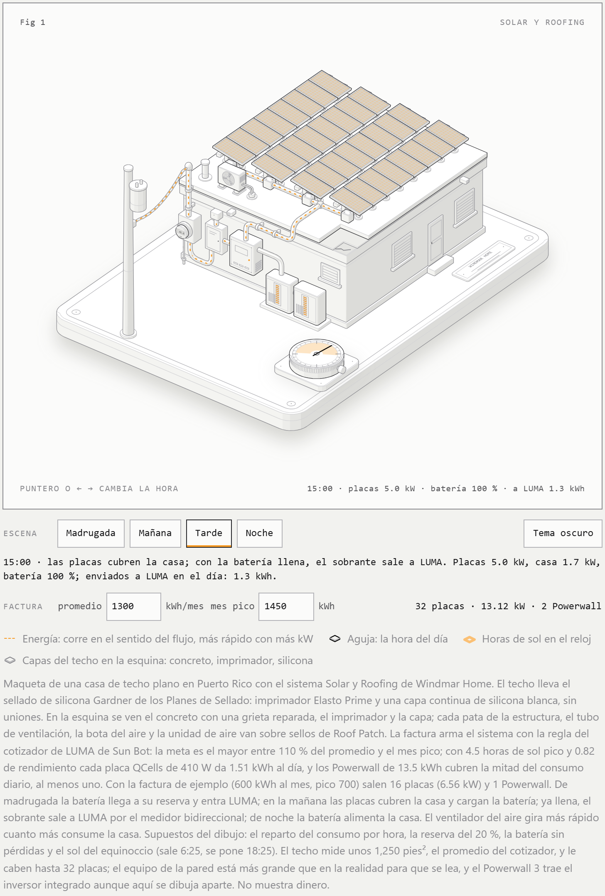
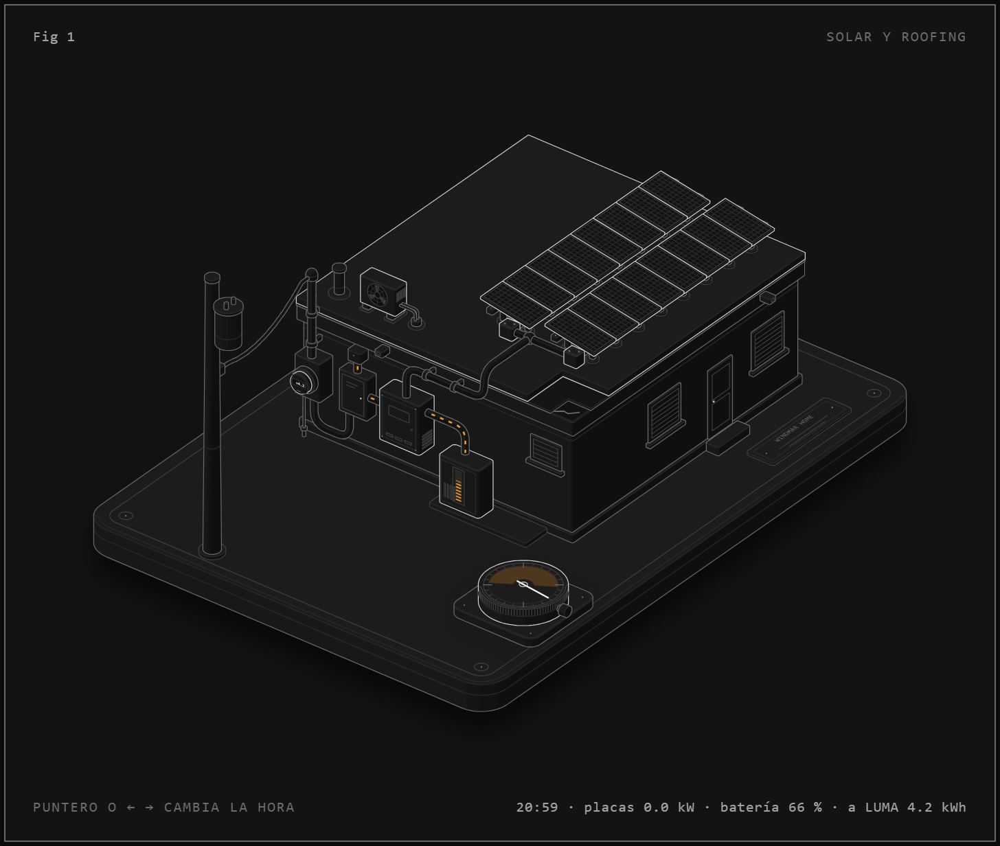

# Figura Solar y Roofing

Figura interactiva que explica cómo funciona un sistema **Solar y Roofing de Windmar Home** en Puerto Rico: el techo sellado, las placas, el inversor, la batería y el medidor de LUMA. Mueves la hora del día y la energía corre por los conductos hacia la casa, la batería o LUMA.

**En línea:** https://figura-solar-y-roofing.vercel.app



## Qué se puede hacer

- **Cambiar la hora** con el puntero sobre la figura, con las flechas del teclado o con las escenas (Madrugada, Mañana, Tarde, Noche). Si nadie la toca, el día corre solo.
- **Escribir una factura de LUMA** (promedio y mes pico). El techo se arma con la regla del cotizador de LUMA de Sun Bot: de 8 a 32 placas y 1 o 2 Powerwall.
- **Pasar a tema oscuro** y volver al claro.
- **Leer lo que pasa:** la esquina de la tarjeta da la hora, los kW de las placas, el % de batería y los kWh netos con LUMA desde la medianoche. El medidor muestra el mismo neto en su pantalla, y debajo de la figura una frase explica el momento.



## Cómo correrlo

Solo hace falta Node 20 o más nuevo; no hay dependencias.

```bash
npm run build
```

Escribe `public/index.html`; ábrelo en el navegador.

```bash
npm run audit
```

Construye y además audita la geometría: que ningún conducto atraviese nada, que cada extremo llegue a una pieza y que el orden de pintado sea el correcto. Tiene que terminar en `audit passed`.

`npm run capture` y `npm run lines` sacan capturas y revisan que cada línea termine sobre algo; usan Google Chrome.

Cada subida a `main` se publica sola en Vercel (team jnsbstnprojects), que corre `node src/build.mjs` y sirve `public/`.

## Estructura

| Ruta | Qué es |
|---|---|
| `src/build.mjs` | Arma la figura: geometría, orden de pintado y la página |
| `src/model.mjs` | Regla de dimensionamiento y modelo de energía del día; corre en la construcción y en la página |
| `src/live.js` | Lo que se mueve: hora, flujo de energía, escenas, factura y tema |
| `src/page.css` | Estilos de la página |
| `public/index.html` | La página construida, la que publica Vercel |
| `vendor/anatomy/` | Kit de figuras isométricas Anatomy, con su licencia MIT |
| `docs/` | Capturas |

## De dónde salen los números

Del cotizador de LUMA de Sun Bot (Windmar Home):

- Placa QCells Q.PEAK DUO BLK ML-G10+ de 410 W.
- 4.5 horas de sol pico en Puerto Rico (NREL) y 0.82 de rendimiento: 1.51 kWh por placa al día.
- La meta es el mayor entre 110 % del promedio y el mes pico; placas = ⌈(meta ÷ 30) ÷ (4.5 × 0.82) × 1000 ÷ 410⌉.
- Powerwall de 13.5 kWh, que cubren la mitad del consumo diario, al menos uno.
- Techo con el sellado de silicona Gardner de los Planes de Sellado: imprimador Elasto Prime y una capa continua de silicona blanca, y Roof Patch en anclajes y penetraciones.

Con la factura de ejemplo (600 kWh al mes, pico de 700) salen 16 placas (6.56 kW) y un Powerwall, que producen 24.2 kWh en un día promedio.

**Supuestos del dibujo**, que no vienen del cotizador:

- El reparto del consumo por hora.
- La reserva de batería del 20 % y la batería sin pérdidas.
- El sol del equinoccio (sale 6:25, se pone 18:25) y la forma de la curva de producción.
- El equipo de la pared se dibuja más grande que en la realidad para que se lea.
- El Powerwall 3 trae el inversor integrado; aquí se dibuja aparte para que se vea.

La figura no muestra dinero.

## Créditos

Hecha con el kit [Anatomy](https://github.com/wheresryan22/anatomy) (MIT, © 2026 Ryan), incluido en `vendor/anatomy` con su licencia.
